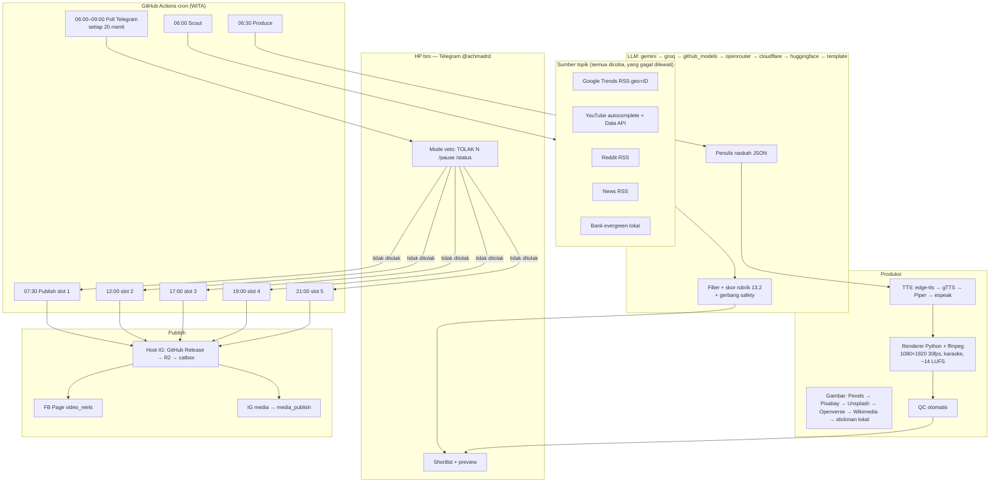

# BLUEPRINT — reels-autopilot (Po Chai / Kreator AI)

Pipeline video pendek **otonom**, **gratis**, dari screening topik sampai publikasi Reels. Dijalankan di **GitHub Actions** (cron, zona **WITA = UTC+8**). Tidak butuh PC atau VPS milik bro. Kode ini **belum di-push** dan **belum mem-publish** apa pun (default `DRY_RUN=true`).

Dasar: *Playbook_FB_IG_Kreator_AI.pdf* bagian 13–16, dilengkapi rantai failover layanan resmi/gratis dan fokus retensi untuk monetisasi (≥5 Reels/hari).

---

## 1. Batasan paling penting: API Meta hanya ke PAGE

“Po Chai” saat ini adalah **profil pribadi mode profesional**. Dokumentasi resmi Meta: *“You can only publish Reels to Facebook Pages.”*

Artinya otomasi penuh **wajib** lewat **Facebook Page** (misalnya Page bernama “Po Chai”) di akun **radinalachmad@gmail.com**, plus Instagram **@achmad_radinal94** diubah ke **Creator atau Business** dan ditautkan ke Page itu.

- Profil pribadi **tetap dipertahankan**; API tidak menulis ke situ.
- IG Content Publishing API **tidak punya parameter jadwal** — job `publish` dipanggil tepat di jam tayang.
- FB Page API mendukung `SCHEDULED` (minimal >10 menit, maksimal 29 hari) dan **30 Reels/24 jam** (docs resmi, playbook).
- Kuota IG: guide 100/24 jam vs referensi `quota_total` 50 — **BELUM DIVERIFIKASI** untuk akun ini; cek endpoint setelah token ada.
- Flag `is_ai_generated=true` dipasang (kebijakan label AI).

---

## 2. Diagram arsitektur

Router provider (`src/reels_autopilot/providers/router.py`) **selalu** mencoba rantai dari **primer ke cadangan**. Jika kuota/429, provider itu masuk **cooldown** sampai waktu reset (mis. tengah malam Pacific untuk Gemini, atau header `Retry-After`). Setelah reset, **primer dicoba lagi lebih dulu**. Status tersimpan di `data/provider_status.json`. Lihat `python -m reels_autopilot providers`.

Kunci API **hanya** milik akun sendiri (arrowmichael17 / radinalachmad). **Tidak pernah** memakai kunci bocor atau bagi-pakai pihak ketiga.

---

## 3. Komponen

| Modul | Fungsi |
|---|---|
| `topic_scout` | Kumpulkan banyak RSS/API, gerbang safety, dedupe, skor, shortlist 5–10 |
| `script_writer` | Naskah JSON 5 adegan, hook &lt;2 detik, tanpa angka karangan |
| `providers.tts` | Suara Indonesia + timestamp kata + loudnorm |
| `stickman` + `renderer` | MP4 9:16, karakter, keyword, karaoke, progress bar |
| `qc` | Resolusi, fps, audio, durasi, LUFS, true peak |
| `publisher` | FB Page + IG, default DRY_RUN |
| `telegram_bot` | `getUpdates` terjadwal (bukan server 24 jam) |
| `state` | `past_topics`, antrian harian, offset Telegram, `/pause` |
| `providers.router` | Failover + cooldown + pulih ke primer |

Perintah: `scout`, `produce`, `publish --slot N`, `poll`, `run-once`, `sample`, `qc`, `providers`, `status`.

---

## 4. Pilihan stack dan alasan

**Renderer v1: Python + Pillow + ffmpeg**, bukan Remotion/stickman-story.

1. Andal di `ubuntu-latest` GitHub Actions: ffmpeg + Python mudah; Remotion butuh Node + Chrome headless, lebih rawan gagal di CI.
2. Otomasi dari JSON naskah: stickman-story menuntut kode TypeScript per video. Untuk 5×/hari tanpa campur tangan, LLM harus menulis TS yang typecheck — lebih rapuh.
3. Menit compute: sampel ini merender **64,5 detik dalam ±85 detik wall-clock**. Remotion (Chrome per-frame) biasanya lebih lambat (**BELUM DIVERIFIKASI** untuk kit ini; tergantung kompleksitas).
4. Tetap gaya playbook: pose idle/walk/sit/typing/point/cheer (+ think/shrug), palet `#0F1B2A` / `#F28C28`, Inter, 1080×1920 30 fps, caption lower-third, target −14 LUFS.

**Jalur upgrade:** setelah pipeline stabil, Remotion + [stickman-story](https://github.com/ahmadaryanto/stickman-story) (MIT) bisa jadi “Jalur A” kualitas visual. Lisensi Remotion **gratis untuk individu / organisasi ≤3 karyawan** (playbook + docs Remotion). Untuk Po Chai itu cukup.

**TTS primer: edge-tts** (suara `id-ID-ArdiNeural`, timestamp kata, tanpa kunci). Tidak resmi — bisa putus. Cadangan: gTTS, lalu Piper offline, lalu espeak-ng.

**LLM primer: Gemini** (Google AI Studio, akun arrowmichael17). Cadangan resmi/gratis berlapis, terakhir template lokal.

**Compute primer: GitHub Actions di repo publik** (standard runner gratis, fair use, docs resmi 2026). Repo privat akun Free: **$12/bulan ≈ 2.000 menit Linux** (docs resmi). Secret tetap tersembunyi di repo publik; yang terlihat adalah kode + state JSON (tanpa token) + video yang memang akan publik.

---

## 5. Rantai failover dan batas tier gratis

Angka yang **tidak** dicek langsung di halaman resmi pada 12 Nov 2026 (WITA) bertanda **BELUM DIVERIFIKASI**. Router **tidak** mengandalkan angka itu; ia merespons 429 / `RESOURCE_EXHAUSTED` / `Retry-After`.

Sumber lengkap: `src/reels_autopilot/providers/catalog.py` (satu sumber kebenaran, dipakai CLI `providers`).

### LLM
| Urutan | Provider | Kunci | Batas (jujur) |
|---|---|---|---|
| 1 | Gemini AI Studio | `GEMINI_API_KEY` | Free tier ada. RPM/TPM/RPD **lihat konsol**. RPD reset 00:00 Pacific (**resmi**, docs 28 Okt 2026). Angka model tidak disalin di sini. |
| 2 | Groq | `GROQ_API_KEY` | Free tier ada. Angka **BELUM DIVERIFIKASI**. |
| 3 | GitHub Models | `GITHUB_MODELS_TOKEN` atau `GITHUB_TOKEN` | Resmi, akun GitHub Free, tanpa kartu. Di Actions: permission `models: read`. RPM **BELUM DIVERIFIKASI**. |
| 4 | OpenRouter `:free` | `OPENROUTER_API_KEY` | Model `:free` berubah-ubah, RPM rendah. **BELUM DIVERIFIKASI**. |
| 5 | Cloudflare Workers AI | `CF_ACCOUNT_ID` + `CF_API_TOKEN` | Alokasi gratis ada; angka “10.000 neurons/hari” sumber lama — **BELUM DIVERIFIKASI**. |
| 6 | Hugging Face Inference | `HF_TOKEN` | Sering berubah/antrian. Jangan primer. **BELUM DIVERIFIKASI**. |
| 7 | Template lokal | — | Selalu ada, tanpa kuota. |

Perkiraan pemakaian 5 video/hari: ±1 panggilan filter + 5 naskah + 5 caption ≈ **11 panggilan/hari**. Cukup untuk kebanyakan free tier, tapi tidak dijamin — itulah gunanya rantai.

### TTS
edge-tts → gTTS → Piper (offline, `PIPER_MODEL`) → espeak-ng. Dua yang pertama **tidak resmi**, tanpa kuota publik. Piper/espeak tanpa kuota, perlu biner di runner.

### Gambar (hanya lisensi komersial — monetisasi)
Pexels → Pixabay → Unsplash → **Openverse** (API resmi CC, filter `license_type=commercial`) → **Wikimedia Commons** (API resmi, CC BY-SA **dilewati** karena share-alike berisiko untuk Reels komersial) → **lokal/stickman**.

Angka rate-limit Pexels/Pixabay/Unsplash **BELUM DIVERIFIKASI**. Atribusi wajib, disimpan di kredit video. Jalur visual utama tetap stickman (tanpa lisensi pihak ketiga).

### Topik
Semua sumber **dipanggil paralel (union)**; yang gagal tidak menggagalkan yang lain: Google Trends RSS ID (dites playbook 12 Nov 2026), YouTube autocomplete (tidak resmi, dites playbook), YouTube Data API (10.000 unit/hari resmi, opsional), Reddit RSS, news RSS (Google News ID, CNN Tekno, The Verge, HN), bank evergreen 20 topik. X API **tidak** dipakai (berbayar).

### Hosting URL publik (wajib untuk IG)
GitHub Releases (repo publik) → Cloudflare R2 → catbox.moe (cadangan terakhir, tanpa SLA). Bandwidth rilis GitHub dan angka R2 “10 GB + 1 juta Class A” **BELUM DIVERIFIKASI** di halaman resmi pada 12 Nov 2026. Artifact Actions (500 MB, resmi) hanya antar-job, **bukan** URL publik.

### Compute
| Jalur | Batas |
|---|---|
| GitHub Actions **publik**, standard runner | Gratis, tanpa batas menit yang dipublikasikan, fair use (**resmi**) |
| GitHub Actions **privat**, akun Free | $12 ≈ **2.000 menit** Linux/bulan (**resmi**). Storage artifact 500 MB. |
| Akun/repo GitHub **kedua** | Cadangan jika fair use/menit tertekan. Secrets diisi ulang. |
| GitLab CI Free (`.gitlab-ci.yml`) | Menit bulanan (angka 300–400 yang beredar) **BELUM DIVERIFIKASI**, mungkin tidak cukup untuk 5/hari. Hanya darurat. |

---

## 6. Kelayakan jujur: 5 video/hari, gratis

Sampel diukur di box ini (12 Nov 2026): **render 64,5 dtk video ≈ 85 dtk wall-clock**, termasuk TTS edge-tts + 1.936 frame + QC.

Estimasi menit Actions (Linux, already rounded up per job):

| Job | Run/hari | Perkiraan |
|---|---|---|
| Scout | 1 | 2–3 menit |
| Produce 5 video | 1 | 10–20 menit (5×~2 menit + setup) |
| Poll Telegram | 12 (hanya 06–09 WITA) | 12–20 menit (termasuk checkout) |
| Publish × 5 | 5 | 10–25 menit (IG bisa menunggu FINISHED s.d. beberapa menit) |
| **Total** | | **±35–70 menit/hari ≈ 1.050–2.100 menit/bulan** |

- **Repo publik: nyaman** untuk 5/hari, masih ada ruang naik volume.
- **Repo privat Free: mepet** di batas 2.000. Poll sudah dibatasi jendela pagi agar tidak habis menit. Jika mepet: turunkan poll, atau pindah ke repo publik.
- Gemini/Groq/dll. 11 panggilan/hari: biasanya muat di free tier; jika 429, router pindah sendiri dan balik setelah reset.
- Meta: 5 FB + 5 IG = 10 publish/hari, jauh di bawah 30 (FB) dan 50–100 (IG).
- edge-tts tidak ada jaminan; Piper offline adalah jaring pengaman.

---

## 7. Monetisasi & retensi (audiens Indonesia)

- Hook selesai &lt;2 detik, **tanpa karakter di depan** (playbook 9.3) — layar teks masalah penonton.
- Durasi ideal **45–90 detik** (batas keras 2:59).
- Caption **karaoke** (banyak yang nonton tanpa bunyi).
- Satu gagasan per adegan, 5 adegan, satu CTA.
- Campuran target **60% evergreen / 40% viral**; bank evergreen 20 topik niche Kreator AI.
- Lima slot WITA: **07:30, 12:00, 17:00, 19:00, 21:00** (jam aktif Indonesia).
- Tidak mengarang angka; gerbang safety menolak SARA, hoaks, tragedi, janji kesehatan/keuangan, bajakan.
- Gambar stok hanya lisensi komersial; default tetap stickman orisinal.
- Label AI di FB; caption jujur soal konten buatan.
- Volume ≥5/hari lewat Page + IG professional — profil pribadi tidak bisa diotomatisasi.

Mode approval default: **`veto`** (otonom, bro bisa `TOLAK N` sebelum jam tayang). `auto` = status saja. `required` = wajib setujui.

---

## 8. Yang BELUM DIVERIFIKASI

- Apakah profil FB pro bisa jadwal **Reels** (bukan post) di app, dan apakah Business Suite mendukung profil pro.
- Batas hari jadwal MBS / app IG (29/30/75 — sumber berbeda).
- Kuota IG API 100 vs 50 di akun @achmad_radinal94.
- Angka RPM/RPD Gemini per model (lihat AI Studio), Groq, GitHub Models, OpenRouter, Workers AI, HF, Pexels, Pixabay, Unsplash, Openverse, R2, GitLab CI, bandwidth GitHub Releases.
- Kode publish **belum** ditembakkan ke akun nyata (sengaja: DRY_RUN, tidak ada token di tes ini).
- Status IG @achmad_radinal94 sudah Creator/Business atau belum (dari brief: belum diketahui).

---

## 9. Yang tidak dilakukan di tahap ini

Tidak membuat akun, tidak login, tidak push, tidak posting. Setup akun = langkah bro (dan Bot nanti, setelah izin) di `SETUP_CHECKLIST.md`.
